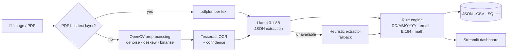

# 🧾 DocAI ETL — AI-Powered Intelligent Document Processing

> An end-to-end **AI-automated ETL platform** that turns scanned images and PDFs (invoices, receipts,
> offer letters, forms) into **clean, validated, structured data**, using **OpenCV**, **Tesseract OCR**,
> **Llama 3 8B** and a **rule-based validation engine**, served through a **Streamlit** client app.


---

## 💼 Business problem

Finance, HR and operations teams still re-type data from invoices, receipts and letters into ERPs and
spreadsheets. It is slow, costly and error-prone, and every vendor writes dates, emails and amounts
differently (`2024-03-15`, `April 14, 2024`, `05.04.2024`, `john [at] acme [dot] com`, `Rs. 1,23,456.50`).

**DocAI ETL** automates the whole flow. Upload a document and the platform returns analytics-ready records in a single,
consistent format, with a full audit trail of every correction it made.

## ✨ Key features

| Stage | What happens | Tech |
|---|---|---|
| **1. Ingest** | PNG, JPG, TIFF (multi-page), BMP, WEBP, PDF; batch upload | Streamlit, Pillow |
| **2. Preprocess** | Grayscale → upscale → non-local-means denoise → **projection-profile auto-deskew** → Otsu / adaptive binarisation | **OpenCV** |
| **3. Extract** | Digital PDFs use the text layer; scanned pages are rendered at 300 DPI and OCR'd with per-word confidence | **Tesseract 5 (LSTM)**, pdfplumber / pdfium |
| **4. AI Transform** | OCR text → schema-constrained JSON (doc type, key fields, dates, emails, phones, amounts, line items) | **Llama 3.1 8B** via Ollama (local) or any OpenAI-compatible API (Groq…) |
| **5. Validate** | Deterministic rules normalise **and** audit every value (see below) | Python rule engine |
| **6. Load** | JSON, CSV, idempotent **SQLite** upsert, history browser | pandas, sqlite3 |

### ✅ Rule engine: "the LLM understands, the rules guarantee"

LLMs are great at *understanding* documents but unreliable at *formatting* them, so the model is told to copy
values verbatim and a deterministic layer enforces the output contract:

| Rule | Input examples (real OCR output) | Output |
|---|---|---|
| **Date → DD/MM/YYYY** | `2024-03-15`, `April 14, 2024`, `05.04.2024`, `5th Nov 2024`, `Sth Nov 2024` *(OCR read 5 as S)*, `12/O3/2024` | `15/03/2024`, `14/04/2024`, `05/04/2024`, `05/11/2024`, `05/11/2024`, `12/03/2024` |
| **Email → standard format** | `Billing@AcmeCloud.cO.IN`, `rohan.mehta [at] pinkcityretail [dot] com`, `HELLO@ChaiPointCafe .com`, `mailto:HR@Co.com` | `billing@acmecloud.co.in`, `rohan.mehta@pinkcityretail.com`, `hello@chaipointcafe.com`, `hr@co.com` |
| **Phone → E.164** | `98765 43210`, `+91-99887-66554`, `0141-2365478` | `+919876543210`, `+919988766554`, `+911412365478` |
| **Amount → number** | `Rs. 1,23,456.50`, `1.234,56 €`, `INR 18,50,000` | `123456.50 (INR)`, `1234.56 (EUR)`, `1850000.00 (INR)` |
| **GSTIN** | `O8ABCDE1234F1Z5` *(OCR O/0 confusion)* | `08ABCDE1234F1Z5` |
| **Invoice math** | qty × rate = amount · Σ line items = subtotal · subtotal + taxes − discount = total | pass / fail |

Real-world edge cases handled:

- **ISO dates are never flipped.** Generic parsers with `dayfirst=True` read `2024-03-12` as 3 December. This engine doesn't.
- **Incomplete dates are rejected.** `dateutil` silently fills a missing day from *today*, which would be a data-corruption bug.
- **Impossible dates fail.** `31/02/2024` is flagged instead of guessed.

Every decision is logged as `pass`, `fixed` or `fail`, and the share of values that pass or get auto-fixed gives each document a **quality score**.

## 🏗️ Architecture



**Resilience:** if the LLM is offline or returns bad JSON, the pipeline automatically falls back to a
deterministic extractor and records a warning, so a batch never fails because of the model.

## 📊 Results on the bundled samples

| Document | Path | OCR confidence | Values auto-fixed | Quality score |
|---|---|---|---|---|
| `invoice_scanned.jpg` (skewed 2.2°, noisy phone scan) | OpenCV + Tesseract | ~93% | 10 | **100%** |
| `receipt_scanned.pdf` (image-only PDF) | pdfium render + Tesseract | ~95% | 5 | **100%** |
| `offer_letter.pdf` (digital PDF) | native text layer | 100% | 6 | **100%** |

Processing time is about 2 s per scanned page on a laptop CPU, plus LLM time.

## 🚀 Quick start (Windows)

```powershell
# 1. Tesseract OCR: install from https://github.com/UB-Mannheim/tesseract/wiki
#    (default path C:\Program Files\Tesseract-OCR is auto-detected)

# 2. Llama 3 8B via Ollama: install from https://ollama.com, then:
ollama pull llama3.1:8b

# 3. Project
git clone https://github.com/<your-username>/ai-document-etl.git
cd ai-document-etl
python -m venv .venv
.venv\Scripts\activate
pip install -r requirements-dev.txt
python scripts/generate_samples.py

# 4. Run
streamlit run app.py        # opens http://localhost:8501
```

macOS / Linux: `brew install tesseract` or `sudo apt install tesseract-ocr`, then use `source .venv/bin/activate`.

> **No GPU or Ollama?** Use Groq's free Llama 3.1 8B: pick *OpenAI-compatible API* in the sidebar, set the base URL
> to `https://api.groq.com/openai/v1`, the model to `llama-3.1-8b-instant`, and paste your API key. Or switch the LLM off to use
> the heuristic extractor.

### 🐳 Docker (app + Ollama)

```bash
docker compose up --build
docker compose exec ollama ollama pull llama3.1:8b   # first run only
```

### ⌨️ Batch CLI (headless ETL)

```bash
python -m docai_etl.cli samples/ --out results.json --csv results.csv --sqlite data/docai_etl.db
python -m docai_etl.cli invoice.png --no-llm
```

### 🐍 Python API

```python
from docai_etl import DocumentETLPipeline, PipelineConfig

pipeline = DocumentETLPipeline(PipelineConfig())
result = pipeline.run(open("invoice.jpg", "rb").read(), "invoice.jpg")
print(result.record["dates"])     # [{'label': 'invoice_date', 'value': '15/03/2024', ...}]
print(result.record["emails"])    # ['billing@acmecloud.co.in', ...]
print(result.quality_score)       # 100.0
```

## 🧪 Testing

```bash
pytest -v
```

The suite has **68 tests**:

- **Rule-engine unit tests:** every date, email, phone, amount and GSTIN edge case.
- **Integration tests:** real OpenCV and Tesseract runs on the scanned and digital samples.
- **LLM tests:** run against a mock Ollama / OpenAI-compatible server, so no GPU is needed and CI stays deterministic.
- **Fallback and loader tests:** LLM-outage fallback and idempotent SQLite loading.

GitHub Actions runs the suite on Python 3.11 and 3.12.

## 📁 Project structure

```
ai-document-etl/
├── app.py                    # Streamlit client application
├── docai_etl/
│   ├── config.py             # dataclass config + env overrides, Tesseract auto-detect
│   ├── preprocessing.py      # OpenCV: denoise, deskew (projection profile), binarise
│   ├── ocr.py                # Tesseract OCR + native/scanned PDF handling
│   ├── llm.py                # Llama 3 8B client (Ollama / OpenAI-compatible), JSON mode
│   ├── heuristics.py         # deterministic fallback extractor
│   ├── rules.py              # rule engine: dates, emails, phones, amounts, GSTIN, math
│   ├── pipeline.py           # ETL orchestration, timings, quality score
│   ├── loaders.py            # JSON / CSV / SQLite loaders
│   └── cli.py                # batch command-line interface
├── scripts/generate_samples.py   # realistic noisy, skewed sample documents
├── samples/                  # demo invoice / receipt / offer letter
├── tests/                    # 68 pytest tests
├── Dockerfile · docker-compose.yml · .github/workflows/ci.yml
└── requirements.txt · .env.example
```

## 🗺️ Roadmap

- Layout-aware extraction (table detection with OpenCV contours / LayoutLMv3)
- Confidence-based human-in-the-loop review queue
- FastAPI microservice and Airflow/Prefect DAG for scheduled folder ingestion
- PostgreSQL / Snowflake loaders

## 👤 Author

**Hemendra Sharma**, Data Scientist · Jaipur, India

Licensed under the MIT License.
